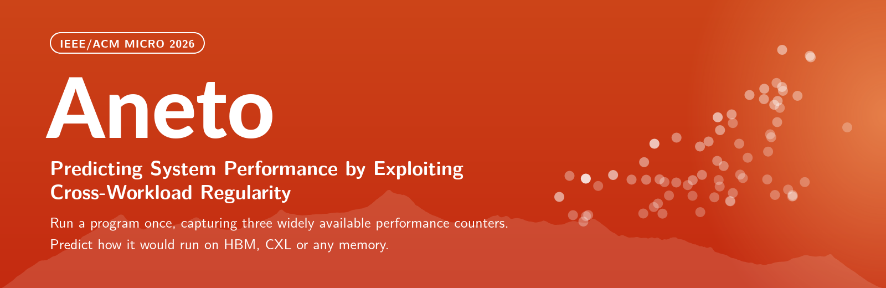

The project page of the MICRO 2026 paper "Aneto: Predicting System Performance by Exploiting
Cross-Workload Regularity" by Raul Taranco, Rene Mueller and Michael Giardino.

- Page: https://huawei-csl.github.io/aneto/
- Paper: https://arxiv.org/abs/2608.07179
- Artifact: https://doi.org/10.5281/zenodo.21554122

GitHub Pages serves the page from `docs/`. The page runs the model in the browser on the
calibrations of the paper.

## License

Copyright (c) 2026 Huawei Technologies Switzerland AG. All rights reserved, except for the
following parts, which keep their own licenses:

- The calibration data in `docs/data/machines.js` is under CC-BY-4.0
  (https://creativecommons.org/licenses/by/4.0/). It is built from the measurement data of the
  aneto-ae artifact (https://doi.org/10.5281/zenodo.21554122).
- The example memory curves in `docs/data/machines.js` come from the MESS simulator
  (https://github.com/bsc-mem/Mess-simulator), Copyright (c) 2025, Barcelona Supercomputing
  Center, under the BSD-3-Clause license (`docs/data/LICENSE-MESS.txt`).
- The fonts in `docs/assets/fonts/`: AnetoDisplay-Heavy.woff is a subset of Lato Heavy 2.015 by
  Lukasz Dziedzic, under the SIL Open Font License 1.1 (`OFL.txt`); as a modified version, it
  does not carry the Reserved Font Name "Lato". Latin Modern is under the GUST Font License
  (`GUST-FONT-LICENSE.txt`).
